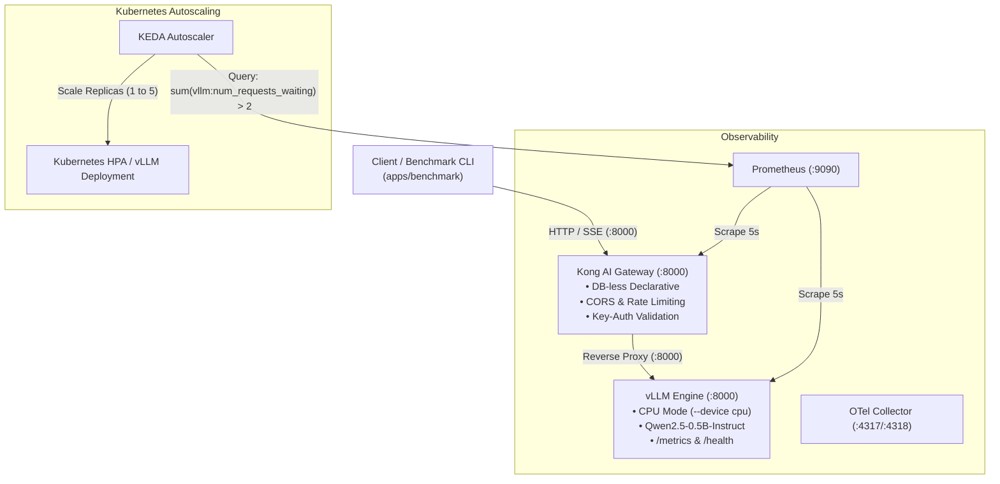

# vLLM Inference Platform

A production-grade, local-first LLM inference platform using CPU mode (zero cloud cost), fronted by Kong AI Gateway with declarative routing and rate-limiting, instrumented with Prometheus & OpenTelemetry, and designed for Kubernetes autoscaling with KEDA.

---

## Architecture Overview



### Key Architectural Highlights
- **Zero-Cloud-Cost CPU Inference**: Runs lightweight quantized/small-parameter models (such as `Qwen/Qwen2.5-0.5B-Instruct` or `meta-llama/Llama-3.2-1B-Instruct`) entirely on CPU with PyTorch optimizations (`--device cpu`, `--enforce-eager`, `--dtype float32`).
- **AI Gateway Ingress**: Kong Gateway 3.6 runs in DB-less mode, providing rate limiting, API key authentication, CORS handling, and Prometheus telemetry.
- **Queue-Aware Autoscaling (KEDA)**: Scales Kubernetes pods dynamically by tracking `vllm:num_requests_waiting` rather than traditional CPU/memory metrics, ensuring rapid scale-up when inference queues build up.
- **Async Streaming Benchmarking**: Custom Python client testing streaming token delivery via Server-Sent Events (SSE), measuring Time-To-First-Token (TTFT), Inter-Token Latency (ITL), and token throughput.

---

## Directory Structure

```
vllm-inference-platform/
├── .github/
│   └── copilot-instructions.md    # Architecture and agent coding invariants
├── docker-compose.yml              # Local orchestration (vLLM + Kong + Prometheus + OTel)
├── .env.example                    # Environment variable configuration template
├── .gitignore                      # Git ignore rules for caches, models, and environments
├── README.md                       # Platform documentation and quickstart
├── config/
│   ├── kong/
│   │   └── kong.yml                # Declarative Kong services, routes, and plugins
│   ├── prometheus/
│   │   └── prometheus.yml          # Prometheus scrape configs for vLLM and Kong
│   └── otel/
│       └── otel-collector-config.yml # OpenTelemetry Collector pipeline definition
├── k8s/
│   ├── base/
│   │   ├── deployment-vllm.yaml    # vLLM Kubernetes Deployment manifest
│   │   ├── service-vllm.yaml       # ClusterIP Service for vLLM
│   │   └── keda-scaledobject.yaml  # KEDA ScaledObject with Prometheus query trigger
│   └── kustomization.yaml          # Root Kustomize manifest
└── apps/
    └── benchmark/
        ├── requirements.txt        # Benchmark client dependencies
        ├── main.py                 # Async streaming benchmark CLI tool
        └── Dockerfile              # Containerized benchmark client
```

---

## 3-Step Quickstart

### Step 1: Start the Platform Locally
Initialize environment variables and launch the Docker Compose stack:

```bash
# 1. Prepare configuration
cp .env.example .env

# 2. Run Docker preflight (check + test + build)
make preflight

# 3. Launch vLLM, Kong Gateway, Prometheus, and OpenTelemetry Collector
make up
```

Check the health status of the services:
```bash
docker compose ps
```

> **Note**: On the first start, vLLM will download model weights for `Qwen/Qwen2.5-0.5B-Instruct` (~1GB). Watch container logs using `docker compose logs -f vllm`. Once ready, Kong will report `healthy`.

### Docker Preflight Commands
The bootstrap now includes a pre-start Docker preflight workflow:

```bash
# Validate docker + compose + syntax
make docker-check

# Validate expected services and healthcheck wiring
make docker-test

# Build local benchmark image and pull runtime images
make docker-build

# Run all stages (check -> test -> build)
make preflight
```

`make up` always runs `make preflight` first. If you need to bypass it temporarily:

```bash
make up-no-preflight
```

### Step 2: Run the Latency & Throughput Benchmark
Run the async streaming benchmark to measure TTFT, ITL, and tokens/second:

```bash
# Optional: create a local virtualenv
python3 -m venv .venv
source .venv/bin/activate
pip install -r apps/benchmark/requirements.txt

# Execute benchmark with 10 requests at concurrency 2
python apps/benchmark/main.py --requests 10 --concurrency 2
```

Alternatively, run the benchmark tool directly with Docker:
```bash
docker build -t vllm-benchmark apps/benchmark
docker run --net=host vllm-benchmark --requests 10 --concurrency 2
```

### Step 3: Inspect Metrics & Gateway Routes

#### 1. Inspect Kong Routes & Health
Verify Kong AI Gateway proxy routes:
```bash
# Check model listing via Kong proxy (Port 8000)
curl -s http://localhost:8000/v1/models | jq .

# Send a sample chat completion request with API key
curl -X POST http://localhost:8000/v1/chat/completions \
  -H "Content-Type: application/json" \
  -H "apikey: secret-api-key" \
  -d '{
    "model": "Qwen/Qwen2.5-0.5B-Instruct",
    "messages": [{"role": "user", "content": "What is Kubernetes?"}],
    "max_tokens": 64
  }' | jq .
```

#### 2. Query Prometheus Metrics
Open [http://localhost:9090](http://localhost:9090) in your browser or run instant queries:

```bash
# Query vLLM waiting requests
curl -s 'http://localhost:9090/api/v1/query?query=vllm:num_requests_waiting' | jq .

# Query Kong request counts
curl -s 'http://localhost:9090/api/v1/query?query=kong_http_requests_total' | jq .
```

---

## Benchmark Metrics Explained

The benchmark client captures three critical low-latency inference metrics:

| Metric | Definition | Importance |
| :--- | :--- | :--- |
| **TTFT** (Time-To-First-Token) | Milliseconds elapsed from HTTP request dispatch until the first SSE chunk is received. | Primary indicator of perceived interactivity and prefill prompt processing speed. |
| **ITL** (Inter-Token Latency) | Delay in milliseconds between consecutive token chunks in the SSE stream. | Determines conversational smoothness and reading experience fluidity. |
| **Throughput (Tokens/sec)** | Number of generated completion tokens divided by total generation duration. | Overall serving capacity metric across concurrent requests. |

---

## Kubernetes Production Deployment & KEDA Autoscaling

### Deploying with Kustomize
Deploy the vLLM inference engine and KEDA autoscaling to your Kubernetes cluster:

```bash
# Preview manifests
kustomize build k8s/

# Apply to cluster
kubectl apply -k k8s/
```

### How KEDA Autoscaling Works
The `k8s/base/keda-scaledobject.yaml` defines autoscaling rules triggered by queue congestion:

```yaml
triggers:
  - type: prometheus
    metadata:
      serverAddress: http://prometheus-k8s:9090
      metricName: vllm_num_requests_waiting
      query: sum(vllm:num_requests_waiting)
      threshold: "2"
```

- **Trigger Metric**: `sum(vllm:num_requests_waiting)`
- **Scale-Up Threshold**: When more than 2 inference requests are queued waiting for compute, KEDA triggers horizontal pod scaling.
- **Replica Range**: Scales dynamically between **1** (baseline) and **5** replicas.
- **Fast Scaling**: Instant scale-up (stabilization window: 0s), with gradual scale-down (120s stabilization window) to avoid flapping.

---

## Observability & Key Metrics Reference

| Component | Port | Target Endpoint | Key PromQL Metric |
| :--- | :--- | :--- | :--- |
| **Kong Proxy** | `8000` | `http://localhost:8000` | `kong_http_requests_total` |
| **Kong Admin** | `8001` | `http://localhost:8001/metrics` | `kong_latency_ms_bucket` |
| **vLLM Engine** | `8002` (direct) / `8000` (internal) | `http://vllm:8000/metrics` | `vllm:num_requests_waiting`<br/>`vllm:gpu_cache_usage_perc` |
| **Prometheus** | `9090` | `http://localhost:9090` | `sum(rate(vllm:request_success_total[1m]))` |
| **OTel Collector** | `4317` (gRPC) / `4318` (HTTP) | `http://localhost:4318` | Traces & OTLP export |

---

## Useful Commands

```bash
# View container logs
docker compose logs -f vllm
docker compose logs -f kong

# Inspect Kong declarative configuration state
curl -s http://localhost:8001/config | jq .

# Stop the platform
docker compose down

# Stop and clean up model cache and Prometheus volumes
docker compose down -v
```
