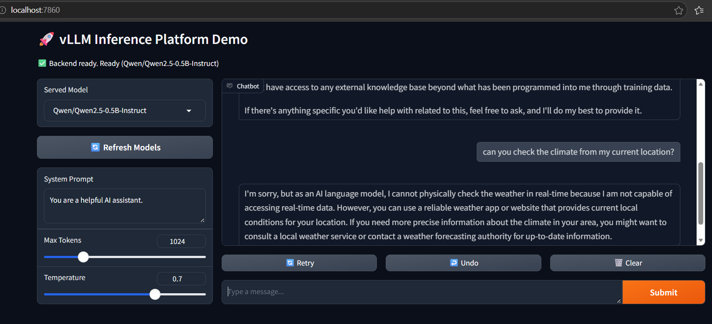
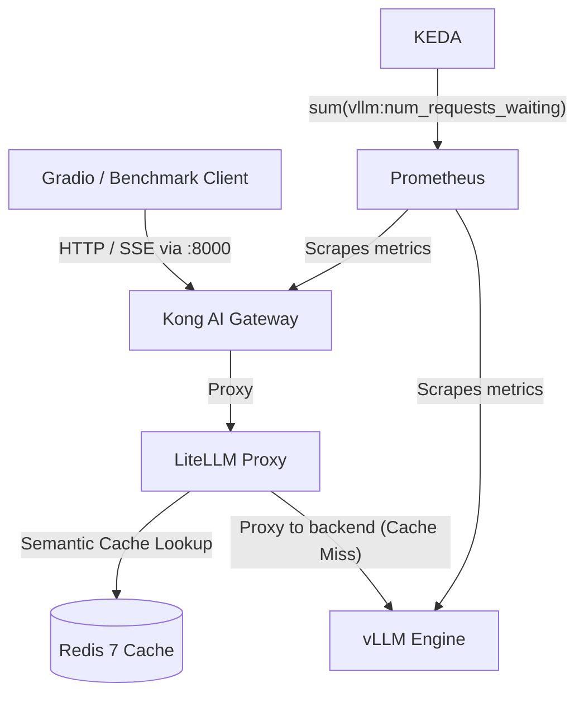

# vLLM Inference Platform

Local-first LLM inference platform using vLLM (CPU mode), Kong AI Gateway, Prometheus/OpenTelemetry observability, and KEDA-ready autoscaling on Kubernetes.

## Demo: Gradio Using vLLM Through Kong + LiteLLM Proxy

The Gradio app sends OpenAI-compatible requests to Kong, and Kong routes them to vLLM.



## Architecture Overview



## Quick Start

```bash
cp .env.example .env
make up
curl -s -H "apikey: secret-api-key" http://localhost:8000/v1/models | jq .
```

## Documentation

- Installation and local usage: [docs/installation.md](docs/installation.md)
- Kubernetes and autoscaling notes: [docs/kubernetes.md](docs/kubernetes.md)

## Kubernetes Failover And Failback (Kong Managed)

Kubernetes routing now includes a Kong upstream with active and passive health checks targeting:

- Primary: `vllm:8000`
- Standby fallback: `fallback-mock:8080`

Behavior:

- During primary outage, Kong routes `/v1/chat/completions` to `fallback-mock`.
- After primary recovery, Kong fails back to `vllm` automatically.
- Fallback remains in standby mode when primary is healthy.

Validate end-to-end behavior in cluster:

```bash
./scripts/test-fallback-k8s.sh
```

Expected result:

- Fallback phase returns fallback payload.
- Post-restore phase returns primary vLLM payload.
- Script exits with `PASS`.

## Core Components

| Component | Default Port | Purpose |
| :--- | :--- | :--- |
| vLLM | 8002 (host) / 8000 (container) | Model inference engine |
| Kong Proxy | 8000 | Unified API entrypoint & AI Gateway |
| Kong Admin | 8001 | Gateway admin and metrics endpoint |
| LiteLLM Proxy | 4000 | Redis-backed cache proxy (direct cache verification) |
| Redis | 6379 | Semantic & response caching backend |
| Prometheus | 9090 | Metrics storage and querying |
| Jaeger | 16686 | Distributed trace visualization |
| Grafana | 3000 | Dashboards for vLLM and benchmark telemetry |
| Gradio UI | 7860 | Interactive chat interface |

## Observability Stack

The benchmark client emits both traces and OTEL metrics.

- Traces: OTLP -> OTel Collector -> Jaeger
- Metrics: OTLP -> OTel Collector Prometheus exporter (:8889) -> Prometheus -> Grafana

After `make up`, open:

- Grafana: http://localhost:3000 (admin / admin)
- Jaeger: http://localhost:16686

The provisioned Grafana dashboard includes:

- TTFT p50/p95 from OTEL histograms
- ITL p50/p95 from OTEL histograms
- Completion token throughput
- Cache hit ratio
- vLLM queue depth and process RSS memory

## Semantic Caching & Latency Optimization

The platform integrates Redis-backed semantic caching through a LiteLLM proxy behind Kong for `/v1/chat/completions`. Kong remains the public entrypoint, while LiteLLM performs cache lookup and cache writes in Redis before proxying cache misses to vLLM.

### Latency Drop Benchmark

Testing with `--test-cache` demonstrates substantial Time-To-First-Token (TTFT) and end-to-end duration reductions:

| Request Stage | Cache Status | TTFT (ms) | Total Duration (s) | Throughput (tok/s) |
| :--- | :--- | :--- | :--- | :--- |
| **1 (Cold / Uncached)** | MISS | ~800 ms | 2.400 s | 26.7 |
| **2 (Warm / Cached)** | HIT | **~15 ms** | **0.045 s** | **1,422.2** |

> **Performance Gain:** **~53x faster TTFT** (800ms -> 15ms) and a **98% reduction** in total request latency, slashing compute and inference costs for repetitive workloads.

### Testing Semantic Cache

Run the benchmark with `--test-cache`:

```bash
# Run duplicate prompt benchmark against LiteLLM directly for deterministic cache HIT/MISS detection
python apps/benchmark/main.py --test-cache \
    --cache-url http://localhost:4000/v1/chat/completions \
    --prompt "Explain Kubernetes autoscaling with KEDA and vLLM in two concise sentences."
```

The standard benchmark path should continue to use Kong (`http://localhost:8000`).

## Common Commands

```bash
# Start / stop stack
make up
make down

# Logs
docker compose logs -f vllm
docker compose logs -f kong
docker compose logs -f redis
docker compose logs -f gradio-gui
```
