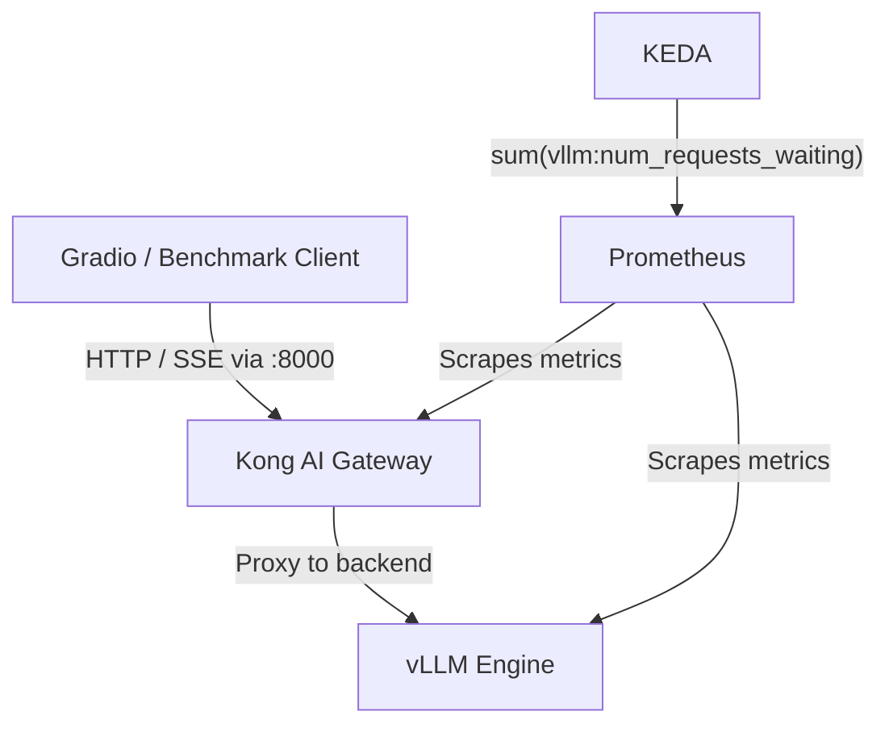

# vLLM Inference Platform

Local-first LLM inference platform using vLLM (CPU mode), Kong AI Gateway, Prometheus/OpenTelemetry observability, and KEDA-ready autoscaling on Kubernetes.

## Demo: Gradio Using vLLM Through Kong

The Gradio app sends OpenAI-compatible requests to Kong, and Kong routes them to vLLM.


## Architecture Overview



## Quick Start

```bash
cp .env.example .env
make up
curl -s -H "apikey: secret-api-key" http://localhost:8000/v1/models | jq .
```

## Documentation

- Installation and local usage: [docs/installation.md](docs/installation.md)
- Kubernetes and autoscaling notes: [docs/kubernetes.md](docs/kubernetes.md)

## Core Components

| Component | Default Port | Purpose |
| :--- | :--- | :--- |
| vLLM | 8002 (host) / 8000 (container) | Model inference engine |
| Kong Proxy | 8000 | Unified API entrypoint |
| Kong Admin | 8001 | Gateway admin and metrics endpoint |
| Prometheus | 9090 | Metrics storage and querying |
| Gradio UI | 7860 | Interactive chat interface |

## Common Commands

```bash
# Start / stop stack
make up
make down

# Logs
docker compose logs -f vllm
docker compose logs -f kong
docker compose logs -f gradio-gui
```
